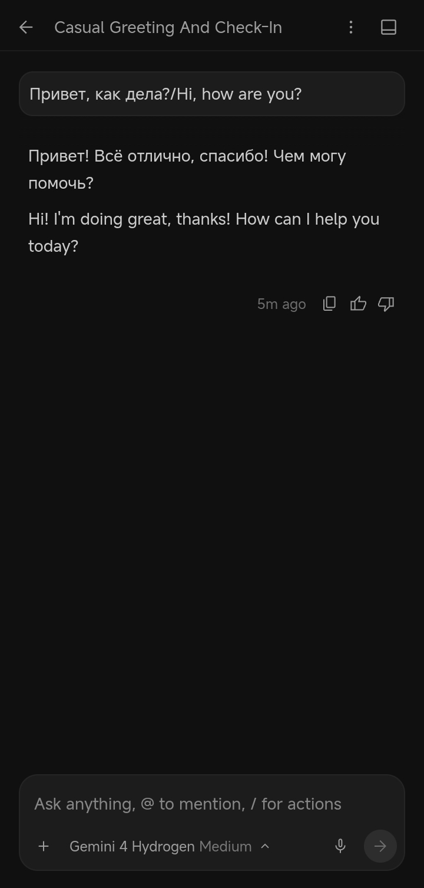

<div align="center">

  <p>
    <b>English</b> &nbsp;&bull;&nbsp; <a href="README.ru.md">Русский</a>
  </p>

  <br/>

  

  # Antigravity for Android

**Autonomous AI development environment running natively on Android & ARM64 (Core `2.34.0`).**

  [](https://android.com)
  [](https://arm.com)
  [](https://github.com/Bananchik0901/antigravity-android/releases)
  [](LICENSE)

  <br/>

  <picture>
    <source media="(prefers-color-scheme: dark)" srcset="docs/assets/hero_dark.jpg">
    <source media="(prefers-color-scheme: light)" srcset="docs/assets/hero_light.jpg">
    
  </picture>

</div>

---

### Overview

**Antigravity for Android** brings autonomous agentic coding directly to mobile hardware.

No PRoot, chroot, or virtualization overhead. Antigravity runs **bare-metal inside native Android userspace (Bionic)**, unleashing the full read/write speed of UFS storage and physical CPU cores. Driven by Gemini models, the agent inspects repositories, authors code across multiple files, compiles binaries, and runs tests completely on-device.

---

### Highlights in v2.34.0.2

* **Bypass synced to `confeden/Antigravity` v2.34.0:** Updated built-in bypass metadata (`2.34.0`) and license key verification to support `MAJOR.MINOR` (`2.34`) salted keys from `@nova_txt` (while keeping backward compatibility with older keys and `agk1.` tokens).
* **Permanent Release Signing Key:** Signed with a dedicated 25-year RSA-2048 release certificate (APK Signature Scheme v2/v3) instead of the Android debug key. *(One-time clean install required when upgrading from `v2.34.0.0` or earlier.)*
* **Antigravity Core `2.34.0` + Android 15–17 Ready:** Updated upstream runtime with `disable_sandbox` & Bionic linker fixes (`LD_LIBRARY_PATH` isolation) and `targetSdkVersion 28`.
* **Two APK Editions:**
  * `Antigravity-2.34.0.2-mobile.apk` — Bypass edition (`@nova_txt` AGU2 local CONNECT proxy `127.0.0.1:45162`, license key check, binary `cli_gate` / `enterprise_auth` / `ineligible` patches).
  * `Antigravity-2.34.0.2-vanilla.apk` — Clean Vanilla edition (100% stock `liblanguage_server.so`, direct networking, no proxy).
* **On-Device Self-Rebuilding Auto-Updater:** Checks Core, Bypass (`confeden/Antigravity`), and full APK releases (`GitHub Releases`), repacks & re-signs the APK on-device (`-autoup` suffix), and supports rollback.
* **Web UI Enhancements:** Exposed `App` and `Browser` settings, mobile `Projects` and `Not in Project: Conversations`, background WebView stream keep-alive, and automatic loopback plugin OAuth.
* **Modular Core & ARMv8.0-A Support:** Clean separation into 6 subsystems (`modules/*`), `liblse_compat.so` + `sigill_handler`, and `agy-daemon`.

---

### Key Features

* **Autonomous Agent:** Plans tasks, edits code across project trees, executes shell tools, and fixes build errors.
* **Elevated Control (Shizuku):** Direct ADB-level operations (`uid=2000`) without root for package installs and system diagnostics.
* **Built-in `pkg` Manager:** Fast package manager installing development runtimes (`git`, `python`, `node`, `clang`) from Termux repos.
* **Adaptive Viewports:** Seamless touch-first mobile UI with optional desktop layout.
* **In-Place Upgrades:** Consistent keystore guarantees updating APKs without losing sessions or workspace data.

---

### Quick Start

1. **Download APK** from [Releases](https://github.com/Bananchik0901/antigravity-android/releases):
   * `Antigravity-2.34.0.2-mobile.apk` — Bypass edition (built-in AGU2 proxy + account gate patches).
   * `Antigravity-2.34.0.2-vanilla.apk` — Clean Vanilla edition (stock core binary, direct connection).
2. **Grant Storage Permission** (`All Files Access`). *(Optional: enable Shizuku or Root for elevated shell access)*.
3. **Install Runtimes** via terminal or agent:
   ```bash
   pkg update && pkg install git python nodejs
   ```

---

### Building & Testing

```bash
# Build Bypass APK (requires phone_base.apk runtime assets + optional tools/.bypass_secrets.json):
python tools/build_final_apk.py

# Build Clean Vanilla APK:
python tools/build_vanilla_apk.py

# Or build via modular shell scripts:
bash build.sh                 # Standard release edition
bash build.sh --region-bypass # Region bypass edition

# Run all test suites:
bash test_all_modules.sh
```

> [!NOTE]
> Relay hostnames and the `agk1.` unwrap key are intentionally kept out of source control (matching upstream `confeden/Antigravity`). Place them in the gitignored `tools/.bypass_secrets.json` (or `AGY_AGU2_T_HEX` / `AGY_PROXY_SERVERS` env vars) if building your own Bypass APK.

---

### Repository Structure

```text
antigravity/
├── config/             # App constants, environment paths, and AI rules
├── modules/            # Decoupled core modules (v2.4+)
│   ├── core/           # Binary unpacking, glibc loader, shims, SHA-256 manifest
│   ├── patches/        # Binary patch engine (syscall emulation, resolv, SIGILL)
│   ├── io/             # High-performance I/O Bus: event broker, FIFO pipes, sockets
│   ├── env/            # Path resolver, diagnostics, Flight Recorder logs, CLI
│   ├── builder/        # Gradle-free APK builder (javac, D8, aapt, zipalign, apksigner)
│   └── runner/         # Standalone runtime preparation, port probe, E2E tests
├── app/                # Android host app (native splash, WebView, system bridges)
├── web/                # Local web frontend, desktop mode toggle, themes
├── env/                # Bionic userspace, Termux overlay, pkg manager, liblse_compat
├── docs/assets/        # Screenshots, banners, and diagrams
├── build.sh            # Root APK build script
└── test_all_modules.sh # Test suite for all 6 modules
```

> [!TIP]
> Each module in `modules/`, `app/`, `web/`, and `env/` includes its own dedicated `README.md` with in-depth technical documentation.

---

<div align="center">
  <sub>Licensed under the <a href="LICENSE">Apache 2.0 License</a></sub>
</div>
