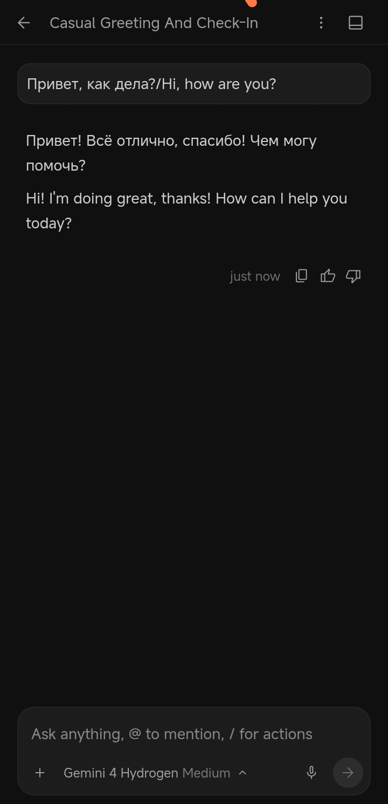

<div align="center">

  <p>
    <a href="README.md">English</a> &nbsp;&bull;&nbsp; <b>Русский</b>
  </p>

  <br/>

  

  # Antigravity для Android

**Автономная среда разработки на базе ИИ, работающая нативно на Android и ARM64 (Ядро `2.32.1`).**

  [](https://android.com)
  [](https://arm.com)
  [](https://github.com/Bananchik09/antigravity-android/releases)
  [](LICENSE)

  <br/>

  

</div>

---

### Обзор

**Antigravity для Android** переносит автономное агентное программирование прямо на мобильное устройство.

Никаких PRoot, chroot или накладных расходов виртуализации. Antigravity исполняется **нативно в пространстве пользователя Android (Bionic)**, раскрывая полную скорость физических ядер CPU и накопителей UFS. Агент на базе моделей Gemini автономно анализирует кодовую базу, редактирует файлы проекта, компилирует бинарники и запускает тесты полностью локально.

---

### Главное в v2.32.1.2

* **Ядро `2.32.1` и поддержка Android 15–17:** Обновлённый рантайм с патчем `disable_sandbox`, изоляцией `LD_LIBRARY_PATH` для Bionic-утилит и `targetSdkVersion 28`.
* **Две редакции APK:**
  * `Antigravity-2.32.1.2-mobile.apk` — редакция с обходом (`@nova_txt` AGU2 локальный CONNECT-прокси `127.0.0.1:45162`, проверка лицензионного ключа, патчи `cli_gate` / `enterprise_auth` / `ineligible`).
  * `Antigravity-2.32.1.2-vanilla.apk` — чистый порт (100% оригинальный `liblanguage_server.so`, прямое подключение без прокси).
* **Встроенный автоапдейтер с пересборкой на устройстве:** Проверяет обновления Ядра, Обхода (`confeden/Antigravity`) и APK на Google Диске, пересобирает и переподписывает APK прямо на телефоне (с пометкой `-autoup`), поддерживает откат версии.
* **Доработки Web UI:** Вкладки *App* и *Browser* в настройках, мобильные *Projects* и *Not in Project: Conversations*, удержание WebView-потоков в фоне и автоматический OAuth для плагинов.
* **Модульная архитектура и ARMv8.0-A:** Разделение на 6 подсистем (`modules/*`), эмуляция атомиков `liblse_compat.so` + `sigill_handler`, микро-демон `agy-daemon`.

---

### Ключевые возможности

* **Автономный агент:** Планирует задачи, правит код по всему проекту, вызывает консольные инструменты и устраняет ошибки сборки.
* **Привилегии Shizuku:** Прямой доступ к ADB-оболочке (`uid=2000`) без root для установки пакетов и чтения системных логов.
* **Встроенный менеджер `pkg`:** Быстрая установка инструментариев (`git`, `python`, `node`, `clang`) из репозиториев Termux.
* **Адаптивный интерфейс:** Удобное сенсорное управление на телефоне с возможностью переключения в десктопный вид.
* **Бесшовные обновления:** Единый ключ подписи гарантирует сохранение сессий и проектов при обновлении APK.

---

### Быстрый старт

1. **Скачайте APK** со страницы [Releases](https://github.com/Bananchik09/antigravity-android/releases):
   * `Antigravity-2.32.1.2-mobile.apk` — версия с обходом (AGU2-прокси + патчи ограничений).
   * `Antigravity-2.32.1.2-vanilla.apk` — чистая версия (оригинальное ядро без прокси).
2. **Предоставьте доступ к памяти** (`Все файлы`). *(Опционально: подключите Shizuku или Root для привилегированной оболочки)*.
3. **Установите рабочее окружение** в терминале или через агента:
   ```bash
   pkg update && pkg install git python nodejs
   ```

---

### Сборка и тестирование

```bash
# Сборка Bypass APK (требуется базовый рантайм и опционально tools/.bypass_secrets.json):
python tools/build_final_apk.py

# Сборка чистого Vanilla APK:
python tools/build_vanilla_apk.py

# Или через модульные shell-скрипты:
bash build.sh                 # Стандартный релиз
bash build.sh --region-bypass # Релиз с обходом проверок

# Запуск полного набора тестов:
bash test_all_modules.sh
```

> [!NOTE]
> Как и в upstream (`confeden/Antigravity`), список релейных узлов и секрет развёртывания ключа `agk1.` не коммитятся в открытый репозиторий. При самостоятельной сборке версии с обходом укажите их в локальном `tools/.bypass_secrets.json` (в `.gitignore`) или через `AGY_AGU2_T_HEX` и `AGY_PROXY_SERVERS`.

---

### Структура проекта

```text
antigravity/
├── config/             # Константы приложения, пути окружения и правила агента
├── modules/            # Модульная архитектура ядра (v2.4+)
│   ├── core/           # Распаковка, glibc-линковщик, системные шимы, SHA-256
│   ├── patches/        # Движок бинарного патчинга (системные вызовы, DNS, SIGILL)
│   ├── io/             # Шина ввода-вывода (I/O Bus): event broker, FIFO, сокеты
│   ├── env/            # Резолвер путей, диагностика, логи Flight Recorder, CLI
│   ├── builder/        # Сборщик APK без Gradle (javac, D8, aapt, zipalign, apksigner)
│   └── runner/         # Подготовка рантайма, health probe, E2E тесты
├── app/                # Android-хост (нативный сплэш, WebView, мосты)
├── web/                # Веб-интерфейс, переключатель desktop mode, темы
├── env/                # Bionic userspace, оверлей Termux, менеджер pkg, liblse_compat
├── docs/assets/        # Скриншоты, баннеры и диаграммы
├── build.sh            # Корневой скрипт сборки APK
└── test_all_modules.sh # Полный набор тестов для всех 6 модулей
```

> [!TIP]
> Каждый модуль в `modules/`, `app/`, `web/` и `env/` содержит собственный файл `README.md` с глубоким описанием архитектуры и компонентов.

---

<div align="center">
  <sub>Распространяется под лицензией <a href="LICENSE">Apache 2.0</a></sub>
</div>
